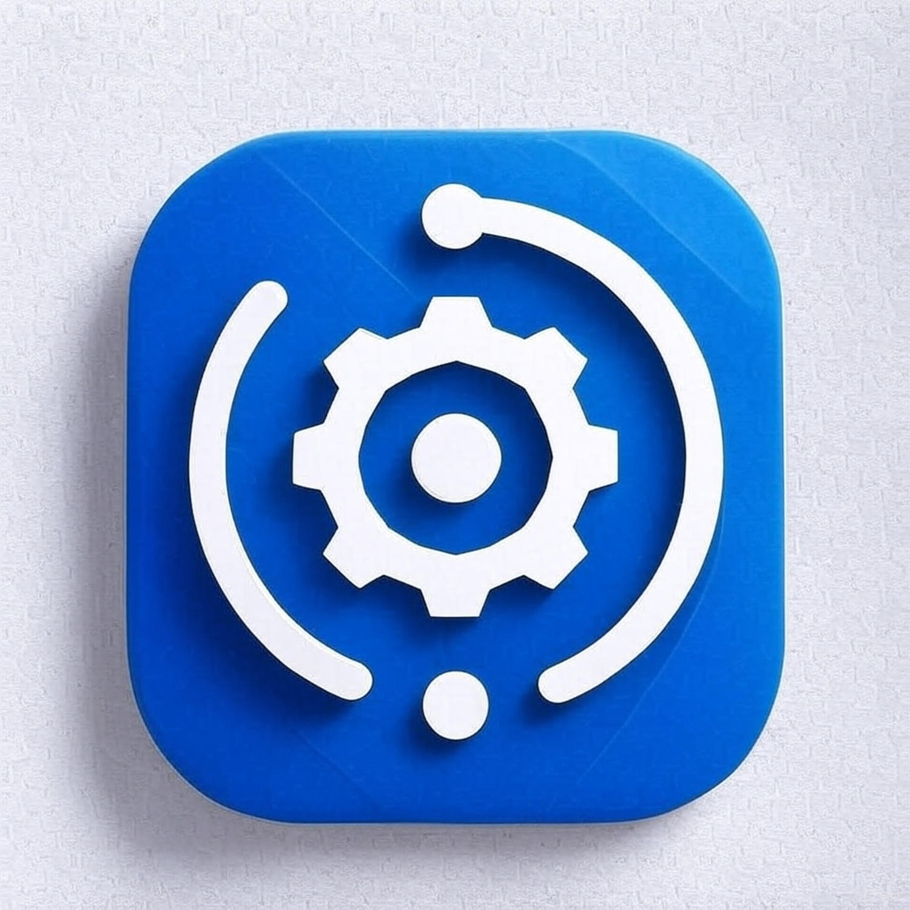

# Flex Flow

<p align="center">
  
</p>

## Introduction

Flex Flow is a task-flow management tool that can be operated locally or remotely.

> [!WARNING]
> Do not run Flex Flow as `root`, with `sudo`, or as a Windows administrator.
>
> Flex Flow is intended for local development and trusted environments. Running it with elevated privileges may expose the host system to serious security risks.

## Network Behavior

The built-in server listens **only on `127.0.0.1`**.  
This is an intentional security design. By default, Flex Flow does **not** accept direct connections from other machines on the network.  
If remote access is required, use a secure forwarding mechanism such as:  
* SSH port forwarding  
* VPN  
* A reverse proxy with proper authentication and access control  
Directly exposing Flex Flow to the public Internet is not supported.

## Security

For the current version:  
* The server is bound to `127.0.0.1` only.  
* Run Flex Flow as an unprivileged user.  
* Do not run Flex Flow with administrator or root privileges.  
* Only use Flex Flow in trusted environments.

## Platform Support

### Prebuilt binaries

Official prebuilt binaries are provided for:  
* Windows 11 x86_64 with UTF-8 enabled  
* macOS on Apple silicon

### Source builds

Building from source is currently tested on:  
* Arch Linux x86_64

Other Linux distributions and CPU architectures may work, but they are not currently tested or officially supported.

## Building from Source

### Build tools

The following tools are required:  
* [Task](https://taskfile.dev)  
* [CMake](https://cmake.org)  
* [Git](https://git-scm.com)  
* A compiler with C++23 support

### Protocol Buffers

* [Buf](https://buf.build)

### C++ dependencies

The C++ dependencies are managed through vcpkg.

#### Model

* C++23  
* Protocol Buffers  
* [SQLite](https://www.sqlite.org)  
* [gRPC](https://grpc.io)  
* [spdlog](https://github.com/gabime/spdlog)  
* [OpenSSL](https://www.openssl.org)

#### Server and CLI

* Model  
* [CLI11](https://github.com/CLIUtils/CLI11)  
* [yaml-cpp](https://github.com/jbeder/yaml-cpp)  

### Web UI

* [pnpm](https://pnpm.io)

### Gateway

* [Go](https://go.dev)

## Build Configuration

Build settings are loaded from the `.env` file in the project root.  
Copy `.env.default` to `.env` before building:  
```sh  
cp .env.default .env  
```  

Review and update the values in `.env` for your environment.  

## Build Commands

Build the C++ model and gRPC server:  
```sh  
task build-cpp  
```  
Build the web UI:  
```sh  
task build-webui  
```  
Build the gateway:  
```sh  
task build-gateway  
```  
Clean generated build files:  
```sh  
task clean  
```  

## Binary Releases

Windows and macOS binaries are available from the GitHub Releases page.  
Linux users should build Flex Flow from source. Arch Linux is the currently tested Linux development environment.  

## License

Flex Flow is licensed under the [MIT License](https://opensource.org/licenses/MIT).  
